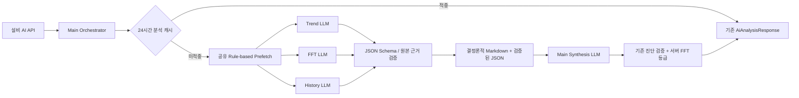

# CMS Multi-Agent 구현 및 검증

## 기존 구조 확인과 재사용

진입점은 `app/main.py`의 `POST /api/dashboard/{dataset_id}/ai-analysis`이다. snapshot 날짜 필터와 legacy FFT ID 유효성 확인 → `build_equipment_context` → `build_equipment_tool_executor` → `AiAnalysisService.analyze` → gateway → 품질 검증 → 기존 응답 순서다. 화면은 `loadDashboard`에서 설비 데이터를 렌더링한 직후 `runAiAnalysis(false)`를 자동 실행한다. FFT 기록 전환은 설비 종합 분석 범위를 바꾸지 않으며 다시 분석은 force를 전달한다.

Prefetch는 `equipment_analysis.py`의 최근 90일 Trend, 기존 Level/상승 Rule, `equipment_evidence.py`의 측정 조건별 FFT 압축·대표 기록·History, `services/fft_status.py`의 최근 7일 집계를 사용한다. 수치 계산은 기존 `app/analysis/`와 서비스 함수에 남아 있다. 설비 Tool의 `get_trend_evidence`는 준비된 Trend/Level을 반환하고, `get_fft_evidence`는 기존 FFT 로더/압축 함수, `get_related_history`는 기존 `build_ai_context`의 엄격한 이력 필터를 사용한다. `list_fft_records` 및 `get_fft_history_evidence`의 날짜·모드·페이지 의미도 유지했다. 챗봇은 `chat.py`·`agent_tools.py`의 기존 executor와 공통 `tool_calling.py`를 계속 사용한다.

외부 JSON은 `AiAnalysisResponse` 안에 기존 headline, riskLevel/Label, trendSummary, fftSummary, fftAnalysisPeriod, fftReferenceRecordIds, 각 findings, likelyCauses, counterEvidence, recommendedActions를 유지한다. 기존 Pydantic schema, `equipment_quality_issues`, FFT 주간 요약 검증을 최종 단계에서도 사용한다. 기존 공통 Tool loop는 최대 4단계/8회였으며 single 분석의 교정은 추가 LLM 요청을 만든다. 실제 비교 표본에서 Tool 호출은 0회였고 지연의 주요 부분은 LLM 추론과 근거 검증 재시도였다. 새 전문 Agent 도구 예산은 전체 4회로 줄였다.

## 구조

API에서 Prefetch를 준비하므로 실제 흐름은 Prefetch 캐시 확인 후 분석 캐시 확인이다. Prefetch 적중 시 원본 fingerprint를 확인하고 압축 결과를 복사한다. 동일 요청의 진행 중 분석은 기존 service에서 공유한다.

Main Orchestrator는 비LLM 조정 계층이다. 근거가 있는 전문 Agent는 각각 별도의 LLM 요청을 병렬 실행하고, Main Synthesis는 검증된 결과를 받은 뒤 별도 LLM 요청을 실행한다. 세 전문 영역이 모두 있는 정상 경로는 4회이며, 근거 없는 영역은 호출하지 않는다.

- Trend: 90일 월평균·변화량, 기존 이동평균 상승 규칙·기울기, 현재/권장 Level, 측정 간격·비가동 정보 한계를 해석한다. 계산·Rule 판정은 바꾸지 않는다.
- FFT: 동일 측정 조건의 1X/2X/3X 및 베어링 성분, Peak·고조파, 과거 대비와 최근 7일 진단을 해석한다. RPM·모드·위치·단위·대역·분해능이 다르거나 불명확하면 수치 비교를 제한한다.
- History: 기존 동일 설비 AND 동일 결함 AND 측정일/조회 종료일 이전, 최대 5건의 사례를 해석한다. Dashboard의 설비 제한 없는 조회는 그대로 유지한다.
- Synthesis: 해석의 일치·상충, 부족한 영역, 점검 순서를 기존 `AiDiagnosis`로 통합한다. 주간 발생 횟수·점수·등급 설명은 서버 원문으로 붙여 재계산을 방지한다.

## Hand-off

LLM이 생성하는 `AgentDraft`는 해석과 근거 ID를 포함한다. 서버가 인용 목록의 합집합을 찾아 `Handoff`에 원본 값·단위·날짜/집계 기간·조건 그룹·출처 경로와 실제 기록 ID를 채운다. 공통 필드는 요청한 12개 필드에 `failure_codes`, `llm_success`, History의 `source_queries`를 더했다.

원본 ID·수치·단위·날짜를 구조적으로 대조하고, 문장의 측정값과 날짜를 연결해 검사한다. 집계 기간 끝점을 실제 관측일로 전용할 수 없다. 원인 후보에는 실제 진단의 지지 근거가 필요하며, 진폭 등급은 물리적 결함을 확정하지 않는다. 모르는 기록·가상 사례·기간 변경·근거 없는 확정은 교정 또는 실패 처리된다.

Markdown은 검증된 JSON에서 한 함수로 생성한다. 화면용 텍스트로 끝나지 않고 실제 Synthesis 요청의 입력에 JSON과 함께 포함된다. Level 수치 단위는 기존 속도 기준인 mm/s로 유지하고, 주파수 축이 bin인 FFT를 Hz로 바꾸거나 결함 지지 근거로 사용하지 않는다. 실패 결과의 원문 해석은 폐기하고 실패 사실과 원본 근거만 전달한다.

실제 외부 LLM 실행에서 생성하고 검증한 [전체 Hand-off JSON](handoff-example.json), [동일 JSON의 결정론적 Markdown](handoff-example.md), [Agent별 실행 지표](execution-metrics.json)를 보존했다. 해당 측정의 Trend·FFT는 별도 실제 LLM 해석이 통과했고, History는 기존 조회의 반환 사례 0건을 표시한 서버 제한 결과다. 실제 History LLM은 이 데이터로 실행하지 않았다. 세 전문 LLM의 독립 호출은 사례가 있는 Mock fixture로 별도 검증했다.

## 캐시·호환성·성능

기존 24시간 메모리/JSON 분석 캐시, force 재분석, 취소 시 진행 중 작업 보호, 원자적 파일 저장을 유지했다. 키에는 실행 모드·모델·분석/Agent/Hand-off 버전·원본 fingerprint가 포함된다. Prefetch도 24시간·최대 32건으로 재사용하며, CSV를 Agent마다 읽지 않는다. 한 Prefetch의 FFT 디코딩 결과를 압축·대표 기록·주간 집계에 재사용한다.

전문 Agent 교정은 1회, Synthesis 교정은 2회, 도구는 single fallback을 포함하여 공유 예산 전체 4회 이하이다. FFT/History만 필요할 때 도구를 사용하고 각 1단계로 제한한다. 시간 예산은 기존 200초 기본값(20초 × 10) 안에서 교정과 single fallback을 포함한다. 사용자의 완성도 우선 선택에 따라 30초를 강제 중단 기준으로 두지 않았다.

외부 응답 DTO, 설비 단위 범위, until과 legacy recordId 검증, force=true, FFT 선택의 의미를 유지했다. 새 브랜치에서는 고정 데모 응답/선택 우회만 제거했고 챗봇의 Agent 구조는 바꾸지 않았다. PPT·이메일은 기존 실제 생성 경로를 사용한다.

## 검증 결과

- 신규 Multi-Agent 테스트: 50개 및 UI 상태 표기 테스트 1개 통과. 병렬 독립 호출, JSON/Markdown 입력, 수치·단위·날짜·ID·기간, 확정 표현과 등급 구분, 부분 실패·교정·fallback, 실제 선택적 FFT Tool 전달, 캐시·force·Prefetch 무효화·API 계약을 확인했다.
- 전체 회귀: 342개 통과, 기존 실패 3개. 화면 served 테스트의 예전 정적 URL 버전 기대값이 현재 demo 코드와 다르며, 수정 전 demo를 `/tmp`에 복제해 같은 실패를 재현했다. 이번 작업에서 해당 화면 계약은 변경하지 않았다.
- 최종 관련 독립 검증: **PASS**, 최종 관련 51개 통과. 앞선 공통 API·챗봇·PPT·이메일 관련 검증도 121개 통과했다.
- 독립 검증 담당자가 발견한 결함 확정/관측일 전용/실패 호출 계수/History cutoff 추적 문제를 수정하고 재검증했다.
- API/캐시 테스트의 asyncio 스레드 완료가 sandbox에서 정체돼 제한 밖에서 실행했다. 코드 변경으로 환경 문제를 우회하지 않았다.
- 실제 LLM 데이터 전송은 사용자 승인 후 실행했다. Key 자체·원본 측정 배열·거부된 AI 원문은 기록하지 않았다.

## 실제 성능 비교

동일 설비 1·같은 snapshot·설정 모델 `gpt-5.6-luna`로 측정했다. 서버 시작의 CSV 로딩 시간은 제외하고 Prefetch부터 최종 분석/캐시 저장까지 포함한다. 원자료는 [benchmark-results.json](benchmark-results.json)에 있다.

| 경로 | 최초 분석 3회 | 중앙값 | LLM 호출 | 결과 |
|---|---|---:|---|---|
| 기존 single | 39.50 / 37.06 / 36.55초 | 37.06초 | 각 3회 | 모두 근거 검증 실패 |
| multi | 27.83 / 26.89 / 19.27초 | 26.89초 | 4 / 4 / 3회 | 모두 응답 성공, fallback 없음 |

Multi 최초 두 표본은 FFT 수치 검증을 2회 통과하지 못해 원본 근거에 한정한 결과로 종합했다. 마지막 표본은 Trend·FFT·Synthesis 각각 한 번에 통과했다. 동일한 품질의 성공 결과끼리 비교한 속도 개선이라고 해석할 수 없다. single은 성공 캐시를 만들지 못해 cache latency를 측정하지 못했다.

Multi cache 5회는 모두 적중했다: 0.1501 / 0.1490 / 0.1485 / 0.1489 / 0.1327초, 중앙값 **0.1489초**, LLM 추가 호출 0회. 세 최초 표본의 모델 Tool 호출도 모두 0회다. Prefetch는 0.93 / 1.03 / 1.00초다.

입력/출력 토큰은 각 52,396/3,710, 52,391/3,396, 39,911/2,904였다. 마지막 정상 경로의 Agent 시간은 Trend 7.57초, FFT 7.97초(병렬), Synthesis 10.28초이며 History 조회 결과는 0건이라 LLM을 생략했다. 제공자 지연과 교정 여부에 따라 다른 설비의 지연은 달라진다.

## 남은 제약

- 자연어의 모든 의미적 허구를 정적으로 증명할 수는 없다. 구조적 인용·수치·단위·날짜·기간·원인 지지 검증과 프롬프트 제한을 함께 사용한다.
- CSV는 기존처럼 서버 시작 시 로딩한다. `force`는 현재 서버가 보유한 원본 데이터로 최신 Prefetch와 LLM 분석을 수행하며, 디스크 CSV 교체는 서버 재시작 후 반영된다.
- 캐시와 도구 예산은 단일 서버 프로세스 기준이다. 다중 worker의 분산 요청 공유, trace 자동 정리, 장기 품질/성능 모니터링은 후속 과제다.
- 제공자/모델의 지연과 교정·fallback 횟수에 따라 응답시간이 달라진다. 성공/실패 표본은 구분해서 비교해야 한다.

## 변경 파일

- `.env.example`
- `README.md`
- `app/agents/__init__.py`
- `app/agents/handoff.py`
- `app/agents/orchestrator.py`
- `app/ai_analysis.py`
- `app/equipment_analysis.py`
- `app/equipment_evidence.py`
- `app/main.py`
- `app/services/fft_status.py`
- `app/static/modules/analysis/ai.js`
- `app/static/modules/api/ai-analysis.js`
- `app/static/modules/api/chat.js`
- `app/static/modules/api/dashboard.js`
- `app/static/modules/api/email-draft.js`
- `app/static/modules/api/history.js`
- `app/static/modules/report/ppt-export.js`
- `app/tool_calling.py`
- `docs/multi-agent/benchmark-results.json`
- `docs/multi-agent/execution-metrics.json`
- `docs/multi-agent/handoff-example.json`
- `docs/multi-agent/handoff-example.md`
- `docs/multi-agent/implementation.md`
- `scripts/benchmark_ai.py`
- `tests/test_demo_presentation.py`
- `tests/test_multi_agent.py`
- `tests/test_ai_wording_ui.py`
- `tests/test_report_ui.py`

실제 서버 `http://127.0.0.1:8000/dashboard?dataset=1`에서 사용자 승인 후 마지막 변경을 반영해 다시 열었으며, AI 완료 상태·한국어 상태 표기·차트 렌더링·콘솔 warning/error 없음을 확인했다. 별도 외부 호출 없는 Mock UI 서버에서는 설비 전환, FFT 선택 시 AI 재호출 없음, 다시 분석 시 재호출, PPT·이메일 버튼 활성화를 확인했다. PPT·이메일 생성은 회귀 테스트로 확인했으며 실제 외부 LLM 생성과 브라우저 다운로드까지 확인한 것은 아니다. 모바일 검증은 요청 범위에 없어 생략했다.

보존된 Hand-off 예시는 최종 실제 대시보드 실행에서 생성한 결과다. Trend 7.35초와 FFT 7.60초가 병렬 실행됐고, Synthesis는 근거 검증 실패 후 1회 교정하여 총 22.49초였다. 전체 Agent 실행 30.16초, LLM 4회, Tool 0회, single fallback 없음이다. History는 기존 조건의 사례가 0건이다. 이 실행의 입력/출력 토큰 합계는 52,807/3,946이며, 기존 벤치마크 표와 다른 최종 화면 검증 표본이다. 교정에 따라 30초를 초과할 수 있다는 제약을 확인했다.
